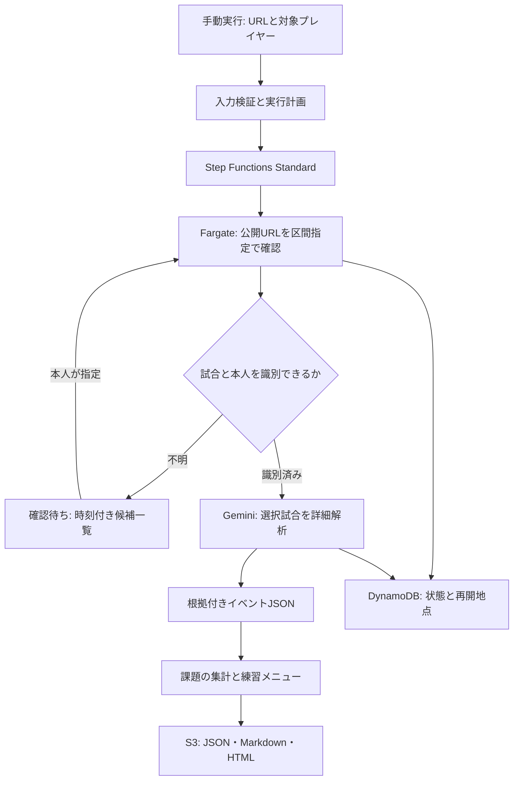

# SF6 Review — 公開YouTube配信から自分の課題を分析する

作成日: 2026-10-11 JST / 状態: 設計・ローカル環境構築。対戦解析本体とAWS実デプロイは未実施。

## 1. 目的と今回の範囲

約3時間の公開YouTube配信URLを1本または複数指定し、任意のタイミングで分析を実行する。既存の配信アーカイブを使い、毎回手作業で試合を切り出すことを避ける。ジュリの「火力不足」を、接触機会・コンボ選択・リソース配分・起き攻め・被弾の観点から検証し、根拠付きの優先課題と練習メニューを返す。一般ランクマと特定フレンド×キャラの重点分析を別モードで持ち、人読みの条件付き反応と経時変化も扱う。

今回作成するもの: 本設計、設定例、依存環境、ネットワークを使わない計画生成CLI、環境診断、AWS基盤CloudFormation、手動Actionsの導入用テンプレート、Claude引継ぎ、検証記録。動画を見たという体裁の模擬レポートは生成しない。

今回未実装: 実動画の取得/分析、Gemini呼び出し、試合の自動認識、コーチング、Fargateワーカー、Step Functions、複数URL投入画面。これらはClaude Codeで実装する。

## 2. 既存環境と共有方針

現行の `Ueter/indeed-ai-assistant` を2026-10-11に読み、次を確認した。

| 項目 | 確認内容 | SF6での利用 |
|---|---|---|
| AWS | アカウント516035591962 / ap-northeast-1 | 同一アカウント・リージョンを使用 |
| GitHub → AWS | OIDC、master限定、GitHubActions-IndeedAiAssistantDeploy | sf6-diagnosis配下に配置し、SF6専用ロールGitHubActions-Sf6ReviewDeployを新設 |
| OIDC subject | owner/repository ID付きの実値を既存テンプレートに記録 | 新リポジトリでは既存ロールをそのまま流用できない |
| 現行求人実行 | Slack → Lambda → SSM → ローカルPC | SF6の処理とは分離 |
| Windows EC2 | 既存コードにDradisWorkerStack、t3.medium、50GB | 現在の稼働状態未確認。動画処理の標準実行先にしない |
| 保存先・秘密値 | 既存S3/DynamoDB/SSMは業務用途 | 同アカウント内にSF6専用資源と/sf6-review名前空間を新規作成 |

AWSアカウントとOIDC Providerは共有する。業務データ、Chromeプロファイル、APIキー、既存の業務ロール権限は混用しない。これは「同じリソースを利用できる」という要望を、同じ基盤・接続方法の利用として具体化した実装方針。Windows EC2自体の再利用が必須とは解釈しない。

今のChatGPT実行環境にはAWS認証、AWS CLI、Docker、Gemini APIキーがない。GitHub接続でリポジトリへの配置はできるが、AWS認証とAPIキーがないためクラウド疎通は未実施。したがって基盤は構築ファイルまで、AWS上の作成・疎通はPCのClaude側で行う。承認待ちという意味ではない。

配置先は `Ueter/sf6-diagnosis/sf6-review/`。リポジトリには既存のスト6診断カルテ `index.html` がある。既存ページの内容を変更せず、動画からの局面データと統計を追加する独立モジュールとして設計する。ページ連携は集計JSONの契約を決めてから行う。SF6専用OIDCロールのbootstrapテンプレートは `infra/github-oidc.json`。既存Indeedロールのtrustを変更しない。

## 3. 全体構成

MVPの起動口はPC CLI。AWSではGitHub Actionsのworkflow_dispatchを追加し、URLを貼って任意起動する。新しい公開WebアプリやSlack投稿は初期範囲に含めない。後から認証付きUIを追加できる。指定URLだけを処理し、新着動画の自動監視は初期に行わない。

## 4. 動画解析の方式

標準経路は公開YouTube URL → Gemini API。Google公式は公開動画のURL入力、静的処理の区間指定とfps指定を案内している。限定公開・非公開は公式仕様上この経路の対象外。ユーザーは公開済みと明示した。

「3時間を一度のプロンプトで完全解析」は採用しない。MVPは静的処理の15分窓、5秒の重複、1fpsで試合候補を探索する。隣接窓をまたぐ試合は絶対時刻で統合し、開始/終了付近を別リクエストで検証する。窓の開始前に始まっていた試合はpartial扱いで無理に勝敗を判定しない。

探索段階では、試合開始/終了、キャラクター、プレイヤー名、本人のサイド、ラウンド結果、確認すべきタイムスタンプを返す。探索は「候補」であり、技やミスの確定判定には使用しない。事前のプレイヤー名と画面上の名前を照合し、ジュリがいるだけで本人と断定しない。サイド入れ替わり、同キャラ戦、低画質、名前の非表示はunknownを許容し、本人確認を挟む。

詳細段階は精度確認のpilotで初期最大5試合。統計モードでは、探索で見つけた対象本人の試合から勝敗に依存せずランダム抽出するか、全件解析する。敗戦だけを選んだ集合の数値を全体の傾向に使用しない。試合を最大180秒の区間に分け、必要なら連続区間をまとめる。5fpsは初期仮説であり、格ゲーの60fps入力や確反判定を保証しない。被弾前後の短区間を追加確認し、フレーム情報や入力履歴がない事実はunknownとする。

URL経路で画質が不足する場合だけ、yt-dlpで本人の公開動画を取得し、FFmpegによる原寸HUD画像/高頻度短クリップを用意する。クラウドからの取得で認証/ボット確認が出た場合は停止し、本人がPCで取得したファイルをS3へ置く経路を案内する。失敗を抜けるためにプロキシ、Cookieの自動抽出、無限リトライを組み込まない。

SF6 Analyzer/Fighter Notesは比較検証の候補。前者は録画映像からイベント集計と開始時刻を記録するWindowsツール、後者は入力履歴・フレームメーター付き1080p60録画を要求する。通常の既存YouTube配信が後者の条件を満たすとは限らない。これらを必須依存にせず、基礎精度の比較用に扱う。

## 5. 出力・事実と推測の扱い

イベントは `observed`（画面で確認）、`inferred`（行動解釈）、`unknown` を持つ。各指摘に動画絶対時刻、対象プレイヤー、根拠、confidence、画面へのリンクを付ける。数字を読むことができなければnull。プレイヤーの意図は推定であり、確認質問を残す。

コンボの「最適解」との比較は、始動、通常/カウンター/パニカン、残りD/SA、風破ストック、位置、パッチが判明している場合だけ行う。現在のゲームパッチと検証したジュリのコンボ表を別ファイルで保持する。数値がない状態で火力不足・確反漏れを断定しない。ダメージ分布とコンボ取りこぼしは別指標。

レポート内容: 対象・分析できた試合数、範囲、本人確認、強み、優先課題3つ、根拠の代表場面、10分程度の練習メニュー、データ不足、次回測る指標。AI指摘回数だけで順位を付けず、機会数を分母にした成功率・損失ダメージ・確信度で判断する。比較用の勝ち試合も含め、負け試合だけによる偏りを明記する。

LLMはGeminiを映像理解の必須候補にし、最終文章はGeminiまたは任意のClaude APIに差し替え可能にする。Claude Codeは開発担当であり、Claude API料金/キーとは別。MVPの必須キーはGeminiだけ。モデル名は利用可能モデルをAPIで確認して設定し、固定の最新モデル名を前提にしない。

## 6. AWS基盤と今回の構築ファイル

`infra/foundation.json` はS3（公開禁止、暗号化、ライフサイクル）、DynamoDB（オンデマンド、PITR）、ECR、ECSクラスタ、CloudWatch Logs、無受信Security Group、専用TaskRole/ExecutionRoleを作るCloudFormation。

基盤スタック名はSf6ReviewFoundation。既存VPCをパラメータで参照し、新しいVPC/NAT/常駐EC2は作らない。画像/実ワーカー未実装なので、基盤にはTaskDefinition/Step Functions/動作している風のダミー分析を含めない。ECSクラスタだけでは解析は起動できない。Claudeが実ワーカー作成後にruntimeスタックを追加する。

実ワーカーの初期案: Linux/AMD64 Fargate、1 vCPU/2GiB、20GiB一時ディスク、同時1ジョブ、実行最大2時間。URL経路では全動画をローカル保存しない。取得経路を使うときは事前にサイズを算出し、一時ディスクを40GiB以上へ変更。既存Public SubnetとPublic IPで外向き通信、受信ポートなし。インターネット経路を実環境で確認する。Public IPv4やログにも費用があり、NATを作らないことと無料は同義ではない。

長時間処理をLambdaに詰め込まない。Step Functions Standard → ECS runTask.syncで起動し、保存結果を見て終了する。失敗捕捉、Taskの停止、実行全体のTimeoutとジョブ状態更新を実装する。Lambdaを使う場合は受付/状態参照だけ。

IAMはSF6のS3バケット、DynamoDBテーブル、/sf6-reviewのSSM読み取りだけをTaskRoleに許可する。GeminiキーはSSM SecureStringへ別途投入し、平文値をIaC/ログ/タスク定義へ埋めない。実行時に取得する。独自KMSキーを使うなら、そのキーに限定したDecryptを追加する。ECR取得・ログ権限はExecutionRole。公開Web配信は設定しない。

## 7. 状態、再開、重複防止

状態: PLANNED → QUEUED → INDEXING → NEEDS_PLAYER_CONFIRMATION / ANALYZING → AGGREGATING → SUCCEEDED。途中でFAILED / CANCELLED / BUDGET_EXCEEDEDへ遷移できる。

IDは正規化したvideo_id、対象絶対時刻、本人識別、パッチ、モデル、設定、prompt_version、pipeline_versionのハッシュ。run_idは個別実行のUUID。DynamoDB条件付き書き込みでleaseを取り、TTLは即時削除やロック解除の保証と見なさない。heartbeat/lease_expires_atをチェックする。上書きする単一SSMジョブ置き場は採用しない。

S3は `checkpoints/{run_id}/` にjob.json/index/window-*.json/matches.json、`evidence/{run_id}/` にevents/*.json/必要画像、`reports/{run_id}/` にreport.json/md/htmlを段階保存する。これにより基盤のprefix別ライフサイクルが効く。成功した窓/試合は再実行しない。API応答受信後の保存失敗で重複課金が起こりうる境界を記録する。429/5xxだけ有限バックオフ、認証/入力/予算エラーは停止。全リトライをAPI回数と予算のカウントに含める。

## 8. コストと保存

初期案: 1実行最大20 APIリクエスト、詳細5試合、同時1件、2時間タイムアウト。API予算例3 USDは価格見積もりでもユーザーの課金同意でもなく、設定例。実行前に利用モデルの現在の単価とtoken estimateを読み、input/output/追加詳細/リトライ分を予約する。単価未設定・見積もり不能ならライブ実行を止める。AWS費用はAPI予算外で別途見積もる。AWS Budgetsは通知であり、即時のハード停止ではない。

raw 7日、evidence 30日、report 365日、index/checkpoint 90日、ログ14日を初期設定とする。原動画は標準経路では保存しない。HTMLはスクリプトなし、モデル出力をescapeして表示する。YouTubeリンクには t=絶対秒 を設定する。音声は必須ではなく、コメントや配信者の会話を戦術の証拠に代用しない。

## 9. 実装・受入基準

1. まず0〜900秒の公開URLで疎通。モデル/キー/料金を設定し、本人と各試合の時刻を手動照合する。
2. 手動で正解ラベルを付けた3〜5試合で、本人サイド誤認0、試合境界の誤差目標±3秒、勝敗誤認0、主要な被弾分類は正解率目標80%以上。いずれも目標であり未達なら詳細断定を抑制する。
3. 同じ15分を再実行してcheckpointが使われ、追加APIコールが不要なことを確認。
4. 3時間一本で窓の境界をまたぐ試合を取りこぼさず、出力にどこまで解析したかを明記。
5. 予算、429、動画削除/アクセス不能、モデル変更、同時依頼、途中キャンセルを確認。
6. その後にFargateへ移し、無人実行後にTaskが終了することと、既存Indeed業務への変更がないことを確認。
7. 複数URLは一本ずつのqueueとして追加。期間比較は十分なサンプルと同じパッチ・設定で行う。

## 10. 参照先

確認日2026-10-11。各数値・仕様は実装直前にも照合する。

- Google公式の動画理解: https://ai.google.dev/gemini-api/docs/generate-content/video-understanding
- Googleモデル・料金: https://ai.google.dev/gemini-api/docs/models / https://ai.google.dev/gemini-api/docs/pricing
- AWS Step FunctionsとFargate: https://docs.aws.amazon.com/step-functions/latest/dg/connect-ecs.html
- Fargate一時ストレージ: https://docs.aws.amazon.com/AmazonECS/latest/developerguide/fargate-task-storage.html
- Lambdaタイムアウト: https://docs.aws.amazon.com/lambda/latest/dg/configuration-timeout.html
- yt-dlp: https://github.com/yt-dlp/yt-dlp
- SF6 Analyzer: https://booth.pm/ja/items/8927876
- Fighter Notes: https://fighter.yuniruyuni.net/
- 既存環境の根拠: Ueter/indeed-ai-assistantのdocs/aws-github-oidc-setup.md、.github/workflows/aws-cdk.yml、infrastructure/github-oidc-role.yaml、infrastructure/lib/dradis-worker-stack.ts、PROJECT_STATUS.md。

## 11. 統計分析を中心にする追加要件（2026-10-11）

ユーザーは「統計的に分析したうえでアドバイス」「起き攻めの期待値」「相手の攻撃をどんな状況で受けがちかの数値」を要求した。単なる印象的なシーン抽出ではなく、機会・選択・結果の構造化と集計を中心機能にする。詳細は `docs/statistical-analysis.md`。

pilotの5試合は抽出精度を検証するためのもの。統計レポートは対象範囲、抽出方法、解析試合数、局面数、欠測率、区間推定を必ず表示する。必要試合数を満たさない場合も記述集計は出せるが、推奨変更は「検証候補」に留める。各予算単位で対象を増やし、同じパッチと抽出設定で累積する。

「起き攻め機会数」「相手の飛び込み機会数」「相手のDI機会数」を母数として記録する。被弾した場面だけから成功率を計算しない。攻撃を受けた回数の構成比と、ある状況に入ったときの被弾確率は別の表にする。

一般ランクマとフレンド戦は別集合。フレンドはopponent_id×キャラ×パッチで履歴を持ち、「投げられた次の起き上がり」など直前の刺激に対する反応を集計する。詳しくは `docs/opponent-analysis.md`。

実装で機会検出を十分に検証できなければ、その成功率/期待値は公開せず、確認済み事例の記述に留める。動画には入力履歴や正確なHP数値がない場合があるので、画面から測った体力割合と正確なゲーム内ダメージを混同しない。
